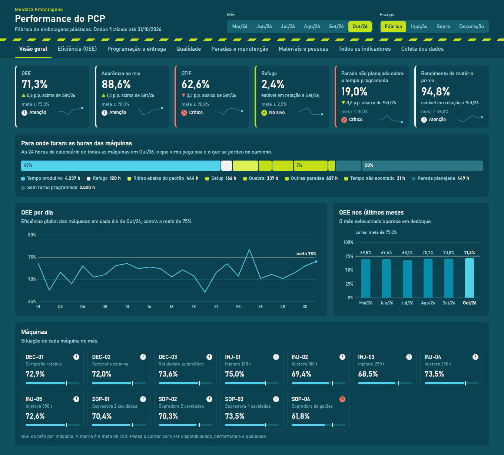
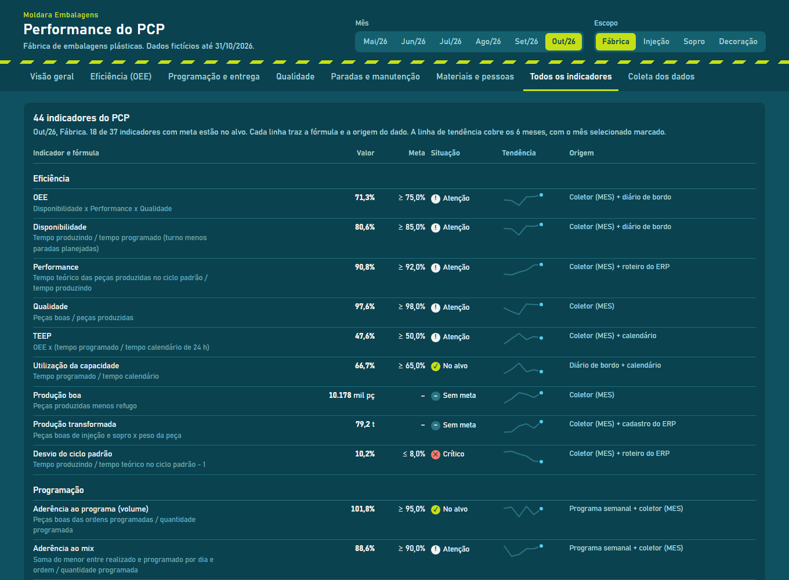
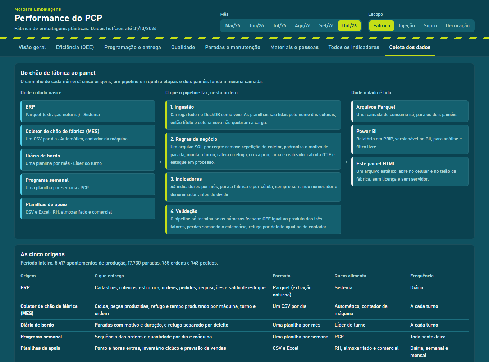
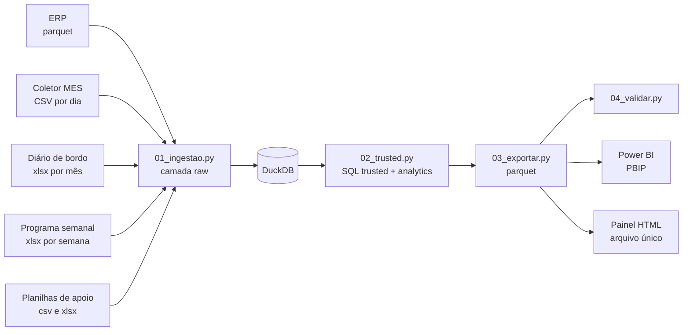

# Performance do PCP — Moldara Embalagens

Projeto completo de indicadores de PCP (Planejamento e Controle da Produção) para uma fábrica de embalagens plásticas: da coleta no chão de fábrica até dois painéis, um em Power BI e um em HTML, lendo a mesma base e com a mesma identidade visual.

> **Dados 100% fictícios.** A Moldara Embalagens, as máquinas, os produtos, os clientes, os operadores e os números são gerados por `gerador/gerar_dados.py` com semente fixa. O projeto reproduz a arquitetura e as regras de um BI industrial, sem nenhum dado real.



| Todos os indicadores | Coleta dos dados |
|---|---|
|  |  |

## O problema de negócio

A fábrica tem 12 máquinas em 3 células (injeção, sopro e decoração), roda em 3 turnos e produz contra pedido. O PCP precisa responder todo dia:

- **Eficiência:** quanto das horas das máquinas vira peça boa (OEE) e onde o resto se perde?
- **Programação:** a fábrica cumpriu o programa da semana, na quantidade, no mix e na sequência?
- **Entrega:** os pedidos saíram no prazo e completos (OTIF)?
- **Qualidade:** quanto se refuga, por qual defeito e quanto isso custa?
- **Paradas:** por que as máquinas param e com que frequência quebram (MTBF, MTTR)?
- **Materiais e pessoas:** o estoque cobre o consumo, o inventário confere, há hora extra demais?

## A sistemática de coleta

O dado de produção não nasce num lugar só. O projeto trata cinco origens, cada uma com seu formato, seu dono e seu defeito típico:

| Origem | O que entrega | Formato | Quem alimenta | Frequência |
|---|---|---|---|---|
| ERP | Cadastros, roteiros, estrutura, ordens, pedidos, requisições, saldo de estoque | Parquet (extração) | Sistema | Diária |
| Coletor de chão de fábrica (MES) | Ciclos, peças, refugo e tempo produzindo por máquina, turno e ordem | 1 CSV por dia | Automático | A cada turno |
| Diário de bordo | Paradas com motivo e duração; refugo por defeito | 1 planilha por mês | Líder do turno | A cada turno |
| Programa semanal | Sequência e quantidade por dia e máquina | 1 planilha por semana | PCP | Sexta-feira |
| Planilhas de apoio | Ponto, inventário cíclico, previsão de vendas | CSV e Excel | RH, almoxarifado, comercial | Diária a mensal |

Os problemas de coleta são simulados de propósito e tratados no pipeline:

| Problema na origem | Tratamento |
|---|---|
| Coletor reenvia o arquivo com linhas repetidas | Mesma máquina, ordem e início: fica uma linha |
| Líder digita o motivo de parada de várias formas ("Troca de molde", "TROCA MOLDE", "setup") | Texto normalizado e traduzido por `config/depara_motivos_parada.csv`; o que não tem de-para vira "Não classificado" e conta como não planejado |
| Refugo da planilha não fecha com o contador da máquina | Vale a quantidade do contador; a planilha só define a proporção por defeito |
| Parada que ninguém anotou | Vira "tempo não apontado" e pesa na disponibilidade |
| Planilha com título, observação e coluna nova | Leitura pelo nome das colunas, procurando a linha de cabeçalho |

A tabela `dq_qualidade_dados` mede quantos registros caíram em cada caso.

## Arquitetura



- **Ingestão** (`pipeline/01_ingestao.py`): carrega as cinco origens no DuckDB como vieram.
- **Trusted** (`pipeline/sql/trusted`): uma regra de negócio por arquivo SQL, comentada.
- **Analytics** (`pipeline/sql/analytics`): os indicadores por mês, a cascata de perdas de tempo, a confiabilidade por máquina e a qualidade dos dados.
- **Exportação**: cada tabela vira um Parquet, lido pelo Power BI e pelo painel HTML. Uma camada só, para o número não divergir entre os dois.
- **Validação** (`pipeline/04_validar.py`): o pipeline só termina se os números fecham.

## Os 44 indicadores

O catálogo fica em `config/indicadores.csv`, com unidade, sentido, meta, fórmula e fonte de cada um. A validação confere que todos têm valor em todos os meses.

| Família | Indicadores |
|---|---|
| Eficiência (9) | OEE, disponibilidade, performance, qualidade, TEEP, utilização da capacidade, produção boa, produção transformada (t), desvio do ciclo padrão |
| Programação (5) | Aderência ao programa (volume), aderência ao mix, aderência à sequência, pontualidade das ordens, carga sobre capacidade |
| Entrega (7) | OTIF, no prazo, completo, atraso médio, ordens em atraso, lead time de produção, lead time do pedido |
| Qualidade (5) | Refugo, retrabalho, FPY, PPM, custo do refugo |
| Paradas e manutenção (7) | Horas paradas, % de parada não planejada, MTBF, MTTR, tempo médio de setup, % em setup, custo das paradas |
| Materiais e estoques (6) | Giro, cobertura, acuracidade do inventário, rupturas, rendimento de matéria-prima, estoque em processo (WIP) |
| Pessoas (3) | Produtividade, horas extras, absenteísmo |
| Demanda (2) | Acurácia e viés da previsão de vendas |

## Regras de negócio principais

| Regra | Definição |
|---|---|
| Tempo programado | Turno de 480 min menos paradas planejadas (refeição, preventiva, sem programa, DDS) |
| Disponibilidade | Tempo produzindo ÷ tempo programado. Setup e tempo não apontado contam como perda |
| Performance | Tempo teórico das peças no ciclo padrão ÷ tempo produzindo |
| Qualidade | Peças boas ÷ peças produzidas. Retrabalho é boa, mas sai do FPY |
| Agregação | OEE de qualquer recorte sai da soma dos tempos e quantidades, nunca da média dos percentuais |
| Aderência ao mix | Menor entre programado e realizado, por dia e ordem, ÷ programado |
| Sequência | Ordem está na sequência se nenhuma que vinha depois no programa começou antes |
| OTIF | Entregue até a data prometida e com quantidade ≥ pedida. Pedido vencido sem entrega conta contra |
| WIP | Peças boas de ordens iniciadas e não encerradas, ao custo padrão, no fim de cada dia |
| Rendimento | Consumo teórico das peças boas ÷ consumo real requisitado |

## Os painéis

**HTML** (`painel_html/saida/index.html`): um arquivo estático, sem servidor e sem dependência externa. Filtros de mês e célula, oito abas (visão geral, OEE, programação e entrega, qualidade, paradas, materiais e pessoas, todos os indicadores, coleta dos dados), funciona no celular. O endereço guarda a aba e os filtros, então dá para compartilhar um recorte.

**Power BI** (`powerbi/PCP_Performance.pbip`): modelo estrela com 13 tabelas e 58 medidas, cinco páginas. O desenho usa **HTML e CSS dentro do Power BI**: 22 medidas DAX devolvem o HTML de cada bloco (cabeçalho, cartões com meta e situação, cascata das horas, quadro de máquinas, barras ordenadas, Pareto com acumulado, tabelas) e o visual [HTML Content](https://appsource.microsoft.com/product/power-bi-visuals/WA200001930) desenha o resultado. A medida é recalculada a cada filtro, então o layout é de página web e o número é do modelo. Séries no tempo e segmentações são visuais nativos, com o mesmo tema.

O PBIP inteiro é gerado por script: `ferramentas/gerar_pbip.py` escreve modelo, medidas e páginas, e `ferramentas/pbip_html.py` guarda os moldes que escrevem o DAX de cada bloco HTML. Mudou um bloco? Edita o molde, roda de novo e o diff do Git mostra o que mudou.

## Paleta

| Papel | Cor | Uso |
|---|---|---|
| Fundo | `#0F5160` | Página |
| Painel | `#0A4250` | Cartões e blocos |
| Ciano | `#53D1EC` | Dado principal: barras, linhas, tempo produtivo |
| Petróleo | `#078CA9` | Meses fora do foco, bordas neutras |
| Lima | `#C5DF16` | Destaque, situação "no alvo", perdas de disponibilidade |
| Lima claro | `#DDF156` | Perda de ritmo |
| Branco | `#F2F2F2` | Texto, marca da meta, situação "atenção" |
| Coral | `#FF7A6B` | Só para a situação "crítico" (única cor fora da paleta) |

A situação nunca depende só da cor: vem sempre com ícone e texto (✓ No alvo, ! Atenção, ✕ Crítico).

## Como rodar

Requisitos: Python 3.11+ e, para o relatório, Power BI Desktop (o visual HTML Content é baixado da AppSource ao abrir).

```bash
pip install -r requirements.txt
python executar_pipeline.py --gerar   # gera a base fictícia e roda tudo (~20 s)
```

Abra `painel_html/saida/index.html` no navegador.

Para o Power BI, o PBIP lê `C:\pcp-moldara\dados\exports\`. Aponte esse caminho para a pasta do projeto e abra o arquivo:

```bash
python ferramentas/configurar_caminho_powerbi.py --atalho   # cria C:\pcp-moldara como atalho para esta pasta
```

Depois abra `powerbi/PCP_Performance.pbip` e clique em **Atualizar**.

## Qualidade

- `pipeline/04_validar.py`: cobertura do catálogo, OEE igual ao produto dos três fatores, cascata de perdas somando o tempo de calendário, refugo por defeito igual ao do coletor, turno sem estourar 480 min.
- `ferramentas/validar_pbip.py`: confere, sem abrir o Power BI, se cada coluna de origem existe no Parquet, se cada campo usado nos visuais e nas relações existe no modelo e se as referências DAX são válidas (`--tmdl` também carrega o modelo com a biblioteca do Power BI Desktop).

## Estrutura

```
gerador/        simulação da fábrica (semente fixa)
config/         catálogo de indicadores, motivos de parada, de-para, feriados
pipeline/       ingestão, SQL trusted/analytics, exportação, validação
dados/brutos/   saída do gerador, no formato de cada origem
dados/exports/  tabelas lidas pelos dois painéis
painel_html/    gerador e modelo do painel HTML
powerbi/        relatório PBIP
ferramentas/    gerador do PBIP, moldes das medidas HTML e validador
kit_coleta/     planilhas de coleta, ficha de turno e importador para usar com dados reais (ver kit_coleta/GUIA.md)
```
